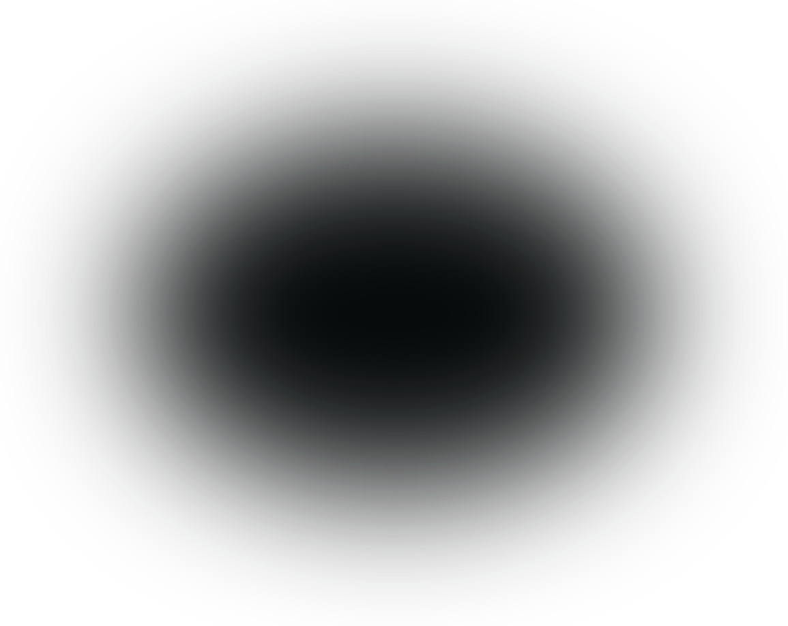

# The animated hero: handoff for the Rails port

> Second draft (2026-10-13, branch `hero-animation`), after the first review round. It is written for the session that
> will move this page into the mock.shop Rails app; it will be finalised after review. Everything marked *measured* was
> run in Playwright's bundled Chromium (headless, Metal WebGL) against this tree served by `python3 -m http.server`
> (or a gzip-serving copy where it says so); items marked *unverified* were not run.

## What it is

The hero (the first screen) carries the design's animated hero, built by Kyu Kim in the designers' repo
(richardli-design/mock-shop-lp, `project/hero-stage/hero-lab/index.html`, commit 1914c8e, R19). Its four layers run on
this page's own hero, with this page's own copy, layout, type, tabs and Copy button:

1. **The field** (`hero/field.js`, ES module): a WebGL stream of light (`canvas#st`) and a room (`div#fl`) of 17
   procedural three.js products flying out of a vanishing point at the copy's centre. It has pointer pan, drag to
   tumble a product, photo cards when there is no WebGL 2, a phone layout at <=900px, and a pause while the hero is
   off screen.
2. **The intro** (`hero/intro.js`, classic script in `<head>`): sets classes on `<html>` before first paint. The
   copy's parts then scale out of the vanishing point, and the headline condenses letter by letter out of up to 640
   canvas particles. It waits for the fonts, with a 1.5s fail-safe.
3. **The beam** (`svg.hbeam` in the hero well): a thin teal light running round the well's ring, paused off screen.
4. **The scrim** (`.hscrim`: an `` here, an inline `<svg>` in Rails) behind the copy, plus two CSS washes over
   the room (`.hero::after`, and a phone fade band `.hero::before`).

With JS off, without module scripts, from `file://`, and whenever the field cannot run (hero/field.js missing,
blocked, refused or unparsable, or throwing before it boots; three.js failing; a page without the hero's markup) the
hero is exactly the static picture it was (`assets/img/hero-bg.webp`).

## Files

| Path | Origin | Size (gzip -9) |
| --- | --- | --- |
| `hero/hero.css` | hand-ported from the lab's `<style>` (lines 31-644); every block cites its upstream lines; PORT NOTES at the top | 17.4 KB (6.3 KB) |
| `hero/intro.js` | **generated** from the lab's inline head script (lines 646-883), 8 edits | 19.9 KB (8.0 KB) |
| `hero/field.js` | **generated** from the lab's module script (lines 1026-8152), 11 edits, RoomEnvironment inlined | 409 KB (140 KB) |
| `hero/vendor/three.module.min.js` | the lab's vendored three.js r170, byte for byte (MIT) | 692 KB (171 KB) |
| `hero/vendor/LICENSE.txt` | three.js's MIT licence (the lab's `vendor/LICENSE`, renamed so its type follows from its extension) | 1 KB |
| `hero/scrim.svg` | the lab's `option-3/scrim.svg`, byte for byte. Rails inlines it instead: the asset pipeline takes no SVG files (see "DOM contract") | 674 B |
| `hero/products/00.webp` ... `88.webp` | the 89 product photos the module can ask for (no-WebGL path only), byte for byte | 1.65 MB, 87 KB max |
| `tools/hero_port.py` | the generator (python3, stdlib only) | |
| `index.html` | `<head>` links, the hero markup, the module script (below) | |

`hero/intro.js` and `hero/field.js` start with a generated **PORT NOTES** comment: the upstream path, commit, the
sha256 of the upstream file, and each edit with its upstream line and reason. Do not edit them by hand. Change
`tools/hero_port.py` and rerun it (see "Re-syncing").

## Load order

Static site (`index.html`):

```html
<head>
  ...
  <link href="https://fonts.googleapis.com/css2?family=Inter...&display=swap" rel="stylesheet">
  <link rel="stylesheet" href="styles.css">
  <link rel="stylesheet" href="hero/hero.css">
  <link rel="modulepreload" href="hero/vendor/three.module.min.js" fetchpriority="low">
  <script src="hero/intro.js"></script>
  <script src="flow/head.js"></script>                <!-- the flow's (FLOW.md, "Load order") -->
</head>
<body>
  ...                                                 <!-- the flow's stylesheet, fonts link and section are in here -->
  <script src="main.js"></script>
  <script type="module" src="hero/field.js" data-hero-field async fetchpriority="low"></script>
  <script async src="flow/flow.js" data-flow-script></script>   <!-- the flow's -->
</body>
```

Why this order:
- `intro.js` is **parser-blocking** (no `async`/`defer`) so that `html.hero-on` and `html.intro` exist before
  first paint. The static picture is then never fetched or shown with JS on (*measured*: `hero-bg.webp` is never
  requested), and the copy's parts start hidden.
- It comes **after the stylesheets**: a classic script waits for the stylesheets before it, so
  `document.fonts.load('340 64px Inter')` can match the font's `@font-face`. Placed before the font stylesheet it
  matches nothing, and the entrance would run on fallback metrics (measured by the head analysis: 0 faces vs 1).
- `field.js` is an **async** module, the last element in `<body>` but for `flow/flow.js`, also async, which follows
  it (FLOW.md). A deferred module (the first draft) held
  DOMContentLoaded until its 400 KB had arrived, and the copy's entrance waits for DOMContentLoaded, so the copy
  stayed invisible until the field's code was in. Async, it runs as soon as it has arrived, before or after
  DOMContentLoaded (both *measured*: it boots either way; it only looks up `#fl`, `.hero`, `.hero__inner`,
  `.hero__copy` and `#st`, all before it in the document, and adds no DOMContentLoaded or load listener). An async
  script holds the load event, so it never runs after `load`. It reads `html.intro` once when it runs; intro.js,
  in `<head>`, has always run by then. *Measured*, 390x844 mobile, gzip-served, CDP throttling:
  - cable (40 ms, 10 Mbps): DOMContentLoaded 673 -> 197 ms; `.go` 686 -> 596 ms, now exactly when both faces are in;
    LCP 1968 -> 1882 ms; the field still boots (data-field="on" at ~1.13 s, about 110 ms later than before: below).
    Uncompressed (python http.server, the review's dcl.py at 1440x900): DOMContentLoaded 1188 -> 293 ms.
  - slow 4G (150 ms, 1.6 Mbps): DOMContentLoaded 4036 -> 871 ms. `.go` is at the 1.5s fail-safe either way
    (~2.0 s), because the faces only arrive at ~3.1 s; LCP stays ~3.15 s (the sub-line after its entrance); the field
    boots at ~4.77 s and draws its first product at ~5.03 s (4.89 s before).
- `fetchpriority="low"` on the module and on the modulepreload: the fonts, styles, main.js and the page's images
  should get the bandwidth first. Under CDP throttling it made no measurable difference to the fonts (on slow 4G they
  still land ~0.7 s later than on the static page, 3.1 s vs 2.45 s: three.js and field.js, ~310 KB gzipped, share the
  pipe), and the field's files arrive ~100 ms later on cable. Real HTTP/2 prioritisation may do better
  (*unverified*).
- `data-hero-field` marks the script for intro.js's error listener (see "Fallbacks"); keep it on the Rails tag.
- `modulepreload` with **the same URL as the dynamic import** makes the import reuse it: one fetch, started during
  parsing (*measured* locally: three.js requested at 7-8 ms). A different URL means two fetches (*measured*: a
  `data-three` that differs from the preload's href loaded three.js twice). With JavaScript disabled, Chromium creates
  the preload request and blocks it at once (Playwright reports it failed with `csp`, Blink's script-disabled
  block): it never reaches the server, and JS off adds only `hero/hero.css` and `hero/scrim.svg` to the page's
  requests (*measured*; other engines *unverified*). With the scrim inline, as in Rails, only `hero/hero.css`.
- `hero.css` after the page's sheet. Its overrides mostly win by specificity (`.hero-on .hero` over `.hero`), but
  that is the order everything was tested in.

Rails layout (a sketch, *unverified*). The real layout (patch 1485) passes `preload_links_header: false` on every tag
to keep the `Link` header to the llms-txt advertisement alone; the hero's tags need it too, or Rails adds
`Link: rel=preload / rel=modulepreload` headers for them:

```erb
<%= stylesheet_link_tag "landing", preload_links_header: false %>
<%= stylesheet_link_tag "hero/hero", preload_links_header: false %>
<link rel="modulepreload" href="<%= asset_path("hero/vendor/three.module.min.js") %>" fetchpriority="low">
<%= javascript_include_tag "landing", preload_links_header: false %>      <%# adds html.js first; intro.js uses classList, so it survives %>
<%= javascript_include_tag "hero/intro", preload_links_header: false %>   <%# synchronous, after the stylesheets %>
...
<%= javascript_include_tag "hero/field", type: "module", async: true, fetchpriority: "low",
      data: { hero_field: "" }, preload_links_header: false %>             <%# last in <body> %>
```

The hand-written `<link rel="modulepreload">` stays as it is (no `crossorigin` attribute: see "CSP"). The landing's
`root_test.rb` pins its tags (`link[rel='stylesheet']` and `script` count 1, `script` 2 with Dux, and no `style` or
`[style]` at all), so the hero's stylesheet and two scripts need those counts raised.

## DOM contract

```html
<section class="hero" aria-labelledby="hero-title">
  <canvas class="st" id="st" aria-hidden="true"></canvas>
  <div class="rm" id="fl" aria-hidden="true"></div>          <!-- Rails: + data-three, data-products -->
  <div class="container hero__inner">
    <div class="hero__copy">
         <!-- Rails: the inline <svg class="hscrim"> (below) -->
      <h1 class="hero__title" id="hero-title"><span>Sample Stores for</span> <span>Building With AI</span></h1>
      <p class="hero__sub">...</p>
      <div class="tabs" role="tablist" ...>...</div>
      <div class="well" id="well-hero" role="tabpanel" ... data-well>
        <pre class="well__code" data-snippet>...</pre>                              <!-- the live snippet (main.js) -->
        <pre class="well__code well__ghost" aria-hidden="true">(Prompt text)</pre>   <!-- three ghosts: main.js's -->
        <pre class="well__code well__ghost" aria-hidden="true">(CLI text)</pre>      <!-- three texts, exactly -->
        <pre class="well__code well__ghost" aria-hidden="true">(Skill text)</pre>
        <svg class="hbeam" aria-hidden="true" focusable="false">...</svg>   <!-- upstream K916-933, every rx 9.5 -->
        <button class="copy-btn" ...>...</button>
        <span class="visually-hidden" role="status" aria-live="polite" data-copy-status></span>
      </div>
    </div>
  </div>
</section>
...
<script type="module" src="hero/field.js" data-hero-field async fetchpriority="low"></script>
```

What each part requires (what breaks otherwise):
- **`#st` then `#fl`**, children of `section.hero`, **before** `.hero__inner`: the stream paints under the room at the
  same z-index. They are the only ids the module looks up. The rest is `hero = room.closest('.hero')`,
  `hin = hero.querySelector('.hero__inner')` and `copy = hero.querySelector('.hero__copy')`. If any of the four is
  missing, field.js takes `hero-on` off and stops quietly (no error; *measured* for each), so a layout that loads
  field.js on a page without the hero partial is harmless.
- **`.hero__copy`'s offsetParent must be `.hero__inner`**, and `.hero__copy` must be positioned. The field computes
  the vanishing point as `hin`'s rect plus `copy.offsetLeft/Top + half its size`. The intro walks `offsetParent` from
  each part up to the copy to set its transform origin (`--hv`), and positions its particle canvas inside the copy.
  hero.css gives `.hero__inner` `position:relative; z-index:2; will-change:transform` under `hero-on` (no border on
  it), and `.hero__copy` `position:relative` always. Do not give `.hero__copy` a z-index, transform or filter.
- **The copy column's size is load-bearing**: `max-width:800px` is the lab's column. The field's lanes push out of
  that box, the stream dims its stars inside it, and the particles spread over its width. With the 1260px container
  instead, 8 of the 17 desktop lanes move (field analysis).
- **The H1's lines are element-child `<span>`s** (the letter split only takes SPAN children; with a `<br>` the
  headline falls back to fading in whole). Keep the space between them for the accessible name in other engines.
- **The entrance's parts** are `h1 > span, .hero__sub, .tabs, .well`, found inside `.hero__copy` by intro.js and by
  the `:is()` lists in hero.css. They are descendants, not children, so Rails' `.snippet` wrapper between the copy and
  the tabs/well should be fine: static elements are skipped by the offsetParent walk (*unverified on the Rails
  markup*). The CTA's `.tabs`/`.well` are outside `.hero__copy` and never animate.
- **The hero well holds its tallest snippet on phones.** Below 640px the well is a column whose snippet wraps, so
  Prompt is 20-40px taller than CLI or Skill, and the phone box centres the copy: without a hold, every tab switch
  moved the headline and the tab under the finger by 10-20px and made the near products jump ~13px. As the lab does
  with `.hghost`, hero.css (under `hero-on`, at <=639px) makes the well one grid cell holding the live snippet and
  three `aria-hidden` ghost `<pre>`s carrying main.js's three texts exactly; the cell is as tall as the tallest, and
  the Copy button keeps its row below. The ghosts have class `well__ghost`, no `data-snippet` (main.js writes the
  first `[data-snippet]`), and come after the live `<pre>`; they are `display:none` everywhere else, so JS off and
  640px and up are unchanged (*measured*: JS-off shots byte-identical at 12 sizes; every tab state's rects identical
  to the first draft's at 640/768/900/1024/1440). *Measured* at 320x568, 360x740, 375x667, 390x844, 412x915 and
  600x900 (mobile): the H1, its lines, sub-line, tab strip and tabs, well, snippet and Copy rects are identical
  across Prompt/CLI/Skill, the field's ResizeObserver does not fire on a switch, and the Prompt state is the first
  draft's (rects identical to 0.000px; held stills pixel-identical, apart from a render variant at 320 and 600 that the
  first draft also shows against itself). The ghosts are out of the accessibility tree, out of a selection's text and out of
  find-in-page. **Rails:** the snippet partial already renders three `<pre class="well__code" data-snippet="...">`,
  two of them `hidden`, so no ghosts are needed: stack those three in the one cell instead, with the hidden ones
  `visibility:hidden` rather than `display:none` (landing.css's `[hidden]{display:none !important}` needs an
  `!important` override), only in the hero well (*unverified*):

  ```css
  @media (max-width:639px){
    .hero-on .hero .well{display:grid;grid-template-columns:minmax(0,1fr)}
    .hero-on .hero .well > .well__code{grid-area:1/1}
    .hero-on .hero .well > .well__code[hidden]{display:block !important;visibility:hidden}
    .hero-on .hero .well > .copy-btn{justify-self:end}
  }
  ```
- **The beam goes in the hero well only**, as a sibling of the snippet `pre`, never inside it (main.js rewrites the
  `pre`'s textContent; Rails' partial has three `pre`s, keep the beam beside them). Its `filter="url(#hbeam-g)"` is
  a same-document reference, a presentation attribute and not CSS, so the filter id must stay unique on the page.
  intro.js finds it with `document.querySelector('.hbeam')` (one beam per page). In the Rails snippet partial, render
  it only when the partial's `id == "hero"`.
- **The scrim** is the first child of `.hero__copy`. On this site it is an `` of `hero/scrim.svg`, hidden unless
  `hero-on` but, as an ``, still fetched with JS off (674 B). **In Rails it goes inline, not through
  `image_tag`.** The landing branch (patch 1485, `saathvik/mock-shop-index-page`) stacks on #1484's static assets
  (`saathvik/mock-shop-static-assets` @ 50500e88), whose `StaticAssetsTest` fails any SVG on the asset load path ("no
  asset is an SVG, which the CDN would serve on mock.shop's own origin with no policy of its own"; its AGENTS.md note
  says to keep SVG inline, as the landing's `_icon` partial does). An `app/assets/images/hero/scrim.svg` fails the
  suite. Upstream's file cannot be pasted in as it is either. Its root's `style="display: block;"` is refused by any
  `style-src` without `'unsafe-inline'`, the landing's included (*measured* under the policy in "CSP": one
  `style-src-attr` violation more than the page's own two), and it fails `root_test.rb`'s
  `assert_select("style, [style]", count: 0)`. Its group's `id="Ellipse 1"` is not a valid HTML id (it has a space).
  Its filter id, `filter0_f_0_65`, is a Figma export's, and inline it joins the page's ids. Render this, on one line,
  as the first child of `.hero__copy`:

  ```html
  <svg class="hscrim" preserveAspectRatio="none" overflow="visible" width="1155" height="919" viewBox="0 0 1155 919" fill="none" xmlns="http://www.w3.org/2000/svg" aria-hidden="true" focusable="false"><g filter="url(#hscrim-blur)"><ellipse cx="577.5" cy="459.5" rx="377.5" ry="259.5" fill="#080B0C"/></g><defs><filter id="hscrim-blur" x="0" y="0" width="1155" height="919" filterUnits="userSpaceOnUse" color-interpolation-filters="sRGB"><feFlood flood-opacity="0" result="BackgroundImageFix"/><feBlend mode="normal" in="SourceGraphic" in2="BackgroundImageFix" result="shape"/><feGaussianBlur stdDeviation="100" result="effect1_foregroundBlur_0_65"/></filter></defs></svg>
  ```

  That is upstream's `scrim.svg` with three edits: the root's `style` dropped, the group's `id` dropped, and the
  filter id renamed `hscrim-blur` (unique on the page, like the beam's `hbeam-g`). It also gains
  `class="hscrim" aria-hidden="true" focusable="false"`, as the landing's icons have. Nothing else is needed:
  landing.css's `img, svg { display: block; }` and hero.css's absolute positioning do what the dropped style did, and
  hero.css's `.hero .hscrim` rules size, place and hide it as they do the ``. *Measured* on a copy of this page
  with that markup in place of the ``:
  - Held stills (`?lab&hold=8`) are identical to the ``'s at 1440x790, dpr 1 and dpr 2 (0 px differ). At
    390x844 mobile, dpr 3 (where hero.css scales the scrim to .62), 24 px are 1/255 off.
  - Under the policy in "CSP" there are only the page's two pre-existing violations. With upstream's root style kept,
    there is a third, on the scrim's line.
  - The accessibility tree (236 nodes) and the 12 tab stops are unchanged.
  - JS off, the page is byte-identical to the pristine one at 1440 and 390, and nothing is fetched for the scrim.
  - Steady-state GPU raster time (per 4 s, 240 frames) is the ``'s at 1440 dpr 1 (168-180 vs 170-176 ms, three
    runs each) and 3-4% more at 1440 dpr 2 (169-170 vs 163-164 ms, two runs) and at 390 dpr 3 (182-188 vs 175-181
    ms, four runs, plus one `` run at 219; a raster `` gave 178-190): at most ~0.03 ms a frame. The beam
    repaints the well, over the scrim, every frame.

  The inline copy costs 669 bytes of HTML (427 gzipped). Safari and Firefox are *unverified*. A raster (WebP) passes
  the test too, but its pixels are not identical: 57-63% of the scrim's pixels are 1-2/255 off (3/255 for a
  quarter-size render). It also weighs 8-55 KB (a quarter-size to a full-size render) where the SVG is 674 B, is
  fetched with JS off as well, and takes a browser to regenerate.
- **The module script carries `data-hero-field`**: intro.js's error listener finds field.js by it (Rails' digested
  name cannot be matched by path).
- **Nothing hooks the page's ids or main.js's attributes** (`#well-hero`, `#tab-hero-*`, `data-tab`,
  `data-snippet-key`), which the Rails markup renames.

Classes and attributes the scripts set:
- intro.js, on `<html>`: `hero-on` (the JS-on hook: only when `'noModule' in HTMLScriptElement.prototype` and not
  `file:`), `intro`, `anim` (wider than 900px; nothing reads it), `pt` (particles on), `go` (the entrance started), and
  `data-glow="blue"` (`?lab&glow=blue`). Elsewhere: `.hbeam.hb-off` while the beam is off screen, and on the H1
  `h1.sq` plus a temporary `aria-label` (its own text) while the letters are split into `span.hl` (plain text again
  after about 1.5s, at most 4s). It also sets `--hv` on each part and `--q` on each letter, and appends the particle
  `<canvas aria-hidden="true">` into `.hero__copy` (removed about 1.64s after `go`). Its error listener takes
  `hero-on` off and sets `section.hero[data-field="off"]` when field.js fails before it boots.
- field.js: everything inside `#fl` (cards, their canvases, hit boxes), `#st`'s width/height and `style.visibility`,
  `html.hit` (`?lab&hit=1`), `section.hero[data-field="on"]` once it has booted, `[data-field="off"]` (and `hero-on`
  off) when three.js failed or the hero's markup is missing, and `window.__p3` (the lab's checks).
- Every style write from JS is CSSOM (`el.style.x =`, `setProperty`, `style.cssText`). None is in markup.

## Asset URLs: `data-three`, `data-products` and the Propshaft digest problem

Propshaft serves every asset under a digested name and only rewrites CSS `url()` and JS `RAILS_ASSET_URL()`. It
does not rewrite module specifiers or `new URL(..., import.meta.url)`, and a precompiled app has no undigested copy
(PLAN.md:32, 115). field.js's own fallbacks are `new URL('vendor/three.module.min.js', import.meta.url)` and
`new URL('products/<id>.webp', import.meta.url)`, files next to field.js. They are right for this static site and
would 404 in the app. So the page passes the URLs in, on `#fl`:

- `data-three`: the URL field.js imports three.js from (`await import(room.dataset.three || <fallback>)`). A relative
  value resolves against field.js's URL, as `import()` does; use `asset_path` (absolute) in Rails.
- `data-products`: an optional JSON object of photo id to URL, parsed once in a try/catch. A missing id, or invalid
  JSON, falls back to the file next to field.js.

```erb
<% hero_photos = (0..88).to_h { |i| id = format("%02d", i); [id, image_path("hero/products/#{id}.webp")] } %>
<div class="rm" id="fl" aria-hidden="true"
     data-three="<%= asset_path("hero/vendor/three.module.min.js") %>"
     data-products="<%= hero_photos.to_json %>"></div>
```

*Measured* on this build (attributes injected through a test route):
`data-three="/hero/vendor/three.module.min.js?digest=abc123"` is imported from exactly that URL, and a
`data-products` map of all 89 ids routes every photo in `?lab&gl=0`. With bad JSON it falls back with no console
output. The `modulepreload` href must be the same `asset_path`. Photos are needed only without WebGL 2, but that path
can ask for any of the 89 over time.

RoomEnvironment (three's example environment, which imported the bare specifier `'three'` through an importmap) is
inlined into field.js, so the module has no static imports at all.

## CSP (measured)

Run with the policy as a response header (`/tmp/hero-port/understand/tools/csp_check.py`, first draft; the review's
`cspserver.py` confirmed it):
- `default-src 'none'; base-uri 'none'; frame-ancestors 'none'; form-action 'none'; script-src 'self';
  style-src 'self'; img-src 'self'; font-src 'self'` gives **exactly the page's two pre-existing violations**: the
  Google Fonts stylesheet (index.html:15) and the icon sprite's `style="position:absolute"` (the sprite near the end of
  index.html, at :343 before the port). The same holds with `?lab&gl=0`. The field boots (WebGL, 19 cards). With the
  flow on the page there is a third, the flow's own Google Fonts stylesheet (index.html:91; the sprite is at :285
  now): *measured* after the flow port, a full scroll at 1440x900 gives those three and nothing from the hero or the
  flow, which still runs (`data-flow="on"`).
- With Google Fonts allowed and `connect-src 'none'; worker-src 'none'`, only the sprite's violation remains, and
  the field boots with all 17 models.

So the hero needs `script-src` for intro.js, field.js and three.js (module import and modulepreload), `style-src` for
hero.css, and `img-src` for the photos (and, on this site, scrim.svg; the Rails page inlines the scrim, which needs no
source). It needs **no** `'unsafe-inline'`, `'unsafe-eval'`, nonce, `connect-src`, `worker-src`, `blob:` or `data:`.
The markup adds no `style=` attribute, inline script, importmap or `<style>`. A `script-src` that misses field.js's
URL now gives the static picture back (intro.js's listener); one that misses three.js's did already (field.js's
catch).

Notes for the app:
- **CDN and CORS** (measured by the review): both production asset paths,
  `https://cdn.shopify.com/shopifycloud/mock_shop/assets/...` and `https://mock.shop/cdn/shopifycloud/mock_shop/assets/...`,
  answer `access-control-allow-origin: *`, so module scripts from either pass CORS with the default credentials mode
  (no `crossorigin` attribute). Keep the `modulepreload` without `crossorigin` (or `crossorigin="anonymous"`) and
  **never** `crossorigin="use-credentials"`: against `ACAO: *` that preload fails CORS, the import reuses the failure
  without fetching again, and the hero falls back to its static picture. The module map is keyed by URL, so a
  credentials-mode difference does not cause a second fetch; a different URL does (two fetches). A CDN that sends no
  ACAO refuses field.js itself: the hero then falls back to its picture too (*measured* with a cross-origin server).
- `landing_assets_test.rb` forbids `url(`, `@import`, `@font-face`, `data:` and `https?://` in the landing
  stylesheet. hero.css contains none of them (checked, comments included). Its landing.js grep (`setAttribute("style"`,
  `innerHTML`, `outerHTML`, `insertAdjacentHTML`, `document.write`, `eval(`, `new Function`, `fetch(`, `XMLHttpRequest`,
  `sendBeacon`, `localStorage`) finds nothing in intro.js or field.js. three.module.min.js contains `fetch(` (three
  hits, in loaders this page never calls), so exclude `vendor/` if the grep is extended to the hero. The generator now
  checks its own output for these (see "Re-syncing").
- hero.css's rules are scoped to the hero, except the header pass-through (`.hero-on .site-header`, outside the
  section) and its six `@keyframes` names, which are document-global and upstream's: `hx-in`, `rm-in`, `hx-pt`,
  `hx-ch`, `hbeam-run`, `hbeam-in`. The static site's other keyframes are the flow's (`fl-up`, `fl-shim`, `fl-rot`,
  `fl-load`, `fl-fire`, `fl-dot`, `fl-blink`, `build-up`: FLOW.md, "DOM contract"), none of them colliding; **grep the Rails landing
  CSS for those six names** before linking hero.css next to it.
- **No SVG files in the pipeline.** #1484's `StaticAssetsTest` fails any `.svg` on the asset load path: a pipeline
  file is served on mock.shop's own origin with no CSP of its own. So the scrim goes inline in the Rails markup (see
  "DOM contract"), as the landing's icons do. On this static site `hero/scrim.svg` stays an ``: an SVG loaded as
  an image is its own document, with scripts off, and the policy above reports nothing for it (*measured*).
- The same test wants a MIME type from every pipeline file's extension ("every asset has a MIME type, which the CDN
  upload labels it with"): hence `LICENSE.txt`.

## Knobs (behind `?lab`)

From the lab, kept verbatim, but read **only when the query has a `lab` parameter** (any value): `?lab&hold=4`,
`?lab=1&pt=0`. Without it the page reads no knob at all and runs as with no query: the published page's visitors
bring their own parameters, and `?t=` is a common cache-buster that was the lab's clock (the room jumped 600s ahead,
the entrance never played, the boot ran as one ~400 ms task; *measured* now: `?t=1700000000`, `?t=5`, `?hold=4`,
`?gl=0`, `?pt=0`, `?glow=blue`, `?hit=1` and `?seed=3` alone all give the plain page). intro.js: `pt=0` (no particles;
the headline fades in with the rest) and `glow=blue`. field.js: `hold=N` (draws the hero N seconds in and freezes it,
pausing **every** animation in the document; this is what makes pixel comparisons possible), `t=N` (runs on without
drawing), `seed=`, `gl=0` (no WebGL: photo cards), `stream=0`, `stars=0`, `fit=0`, `hit=1` (outlines the hit boxes),
and about fifty number knobs (`drift=`, `sz=`, `focus=`, ...; see the field's `num()` calls). `window.__p3` exposes
`cards()`, `lanes()`, `stream()`, `boot()`, `held()`, `t()`, `run(T)` and `gl`, with or without `?lab`.

## Fallbacks and modes

| Situation | What happens (measured unless noted) |
| --- | --- |
| JS off | today's static hero: screenshots byte-identical to the pristine site at 1920x1080, 1440x900, 1280x800, 1024x768, 960x800, 768x1024, 600x900, 412x915, 390x844, 375x667, 360x740 and 320x568 (phones mobile, dpr 3), and the whole page at 1440 and 390. It requests only `hero/hero.css` and `hero/scrim.svg` beyond the static page: Chromium blocks the three.js modulepreload with JS off (other engines *unverified*). With the scrim inline (the Rails markup) only `hero/hero.css`, and the shots are still byte-identical at 1440 and 390 (*measured* on a copy of this page) |
| No module scripts / `file://` | `hero-on` is not set, so the static picture stays, with no beam or scrim; the intro still plays over it (*measured* from `file://`). Chrome logs its own CORS refusal of the module and the modulepreload there: 4 console errors the static page did not have |
| hero/field.js fails: 404, network abort, refused by a CSP, refused by CORS, a parse error (a module-capable browser without top-level await: Chrome/Firefox <= 88, Safari <= 14), or a throw before it has booted | intro.js's capture-phase `error` listener (edit 6) takes `hero-on` off and sets `data-field="off"`. Measured for each of those (the throws: right after three.js loads, after the stream has started drawing, and inside a boot-time rAF callback): the static picture is back, identical to the pristine viewport at 1440 (0 px differ) and at 390 within the pristine page's own raster noise; no beam, scrim or washes; the intro completes (parts opaque, letters back to text, the H1's aria-label gone); no animation frames afterwards. The console has only the browser's own load error, or the simulated failure itself |
| three.js fails (blocked, offline, CSP) | field.js's catch: `hero-on` comes off, the static picture returns (0 px differ at 1440), `data-field="off"`, no beam/scrim/washes, no uncaught error. The only console line is Chrome's own network error for the failed request |
| A page that loads field.js without `#fl`, `.hero`, `.hero__inner` or `.hero__copy` | field.js takes `hero-on` off and stops quietly: static picture, no console output (*measured* for each of the four) |
| No WebGL 2 (WebGL off, no GPU, a WebGL 1-only browser) / `?lab&gl=0` | photo cards only (10 at 1440, 4 at 390), from `products/` or `data-products`; the stream canvas stays blank (hidden in a WebGL 1-only browser, upstream). No console output: makeGL asks a throwaway canvas for WebGL 2 first (edit 9), where three r170 used to log three `console.error` lines (*measured* with `--disable-webgl`, `--disable-3d-apis`, `--disable-webgl2`) |
| Reduced motion | `html` gets only `hero-on`; no intro, no beam; the field draws one still room (17 products at home, clock stays 0, `data-field="on"`); upstream still lets a drag turn a product |
| Phone, <=900px | the field's phone layout. Under JS on, the hero takes the lab's phone box (min-height 100svh, padding 96/48, centred), so it is 844px tall at 390x844 instead of 646 and the content below moves down (a deliberate change; see TODO.md). The page's phone copy is taller than the lab's (454 vs 344px at 390x844), so the phone lanes are tighter: at 390x844, 6 of the 8 active lanes are pushed 11-55px further out (exit pX 1.53-1.67 vs the lab's 1.67-2.12), products leave sooner and the next one fades in almost at home (softIn .043 vs .06-.22). On small phones few products show: mean near products >=60% on screen, port vs lab, 375x667 0.12 vs 1.23, 360x740 0.46 vs 1.58, 360x800 0.92 vs 2.27, 390x844 1.46 vs 2.42, 393x852 1.69 vs 2.46, 412x915 1.85 vs 3.00, 430x932 2.23 vs 2.96 (the review's counts; 375x667 and 390x844 re-measured on this build: 0.12 and 1.38). Until the mobile design lands |
| Snippet tab on a phone (<=639px) | nothing moves: the well holds its tallest snippet's height (the ghosts, above), so the copy keeps its size and the ResizeObserver (edit 7) stays quiet. The observer still re-measures for other changes of the copy's or the room's size (*measured*: a CSSOM change of the sub-line's size, one call) |
| 901-1023px | the desktop layout in the page's 640px tablet hero; the washes' centre is moved to the copy's measured centre (310px) |
| Hero off screen | the field's clock and drawing stop (IntersectionObserver on `#fl`) and the beam pauses (`hb-off`); both resume on return |
| Pinch on a product (touch) | zooms the page: `touch-action: pan-y pinch-zoom` on the products (the lab has `pan-y`, which blocked a pinch that started on one). A horizontal swipe still tumbles the product and a vertical one scrolls (*measured*) |
| WebGL context lost | the field calls `preventDefault()` on `webglcontextlost`, so the browser can restore the context; three re-initialises on `webglcontextrestored` and the products come back (*measured* with `WEBGL_lose_context` on the products' context: ink 28,475 before, 0 during, 31,857 three seconds after the restore, on the lab and the port alike). They stay gone only if the browser never restores the context. three logs "Context Lost." / "Context Restored." at console.log level |

## Budget (measured)

- **Bytes:** the hero adds about **325 KB gzipped**: three.js 171 KB, field.js 140 KB, intro.js 8.0 KB, hero.css
  6.3 KB, scrim 0.4 KB (in Rails, inline in the HTML); 1.14 MB uncompressed. With JS on, `hero-bg.webp` (26 KB) is
  no longer fetched. PLAN.md's budget (~/mock-shop-work-items/PLAN.md, "Budget") has five lines; the hero keeps two
  (any single image <= 300 KB: its largest is an 87 KB photo; fonts <= 110 KB: it adds none) and breaks three
  (same-origin bytes, text at gzip -9, images raw, Google Fonts excluded; 1440x900 and 390x844 give the same set):
  - **HTML+CSS+JS <= 40 KB compressed:** 21.6 KB -> **347 KB** (index.html 8.3 -> 9.0 KB). It cannot hold with the
    hero in it: keep three.js and the field outside that line or revise it.
  - **First view <= 450 KB:** 420 KB -> **720 KB** (+299 KB; 17 -> 21 requests: hero.css, intro.js, three.js,
    field.js and the scrim in, hero-bg.webp out). With `?lab&gl=0` (the no-WebGL path) 970 KB at 5s and rising as
    photos stream in (the set is 1.65 MB, 87 KB at most each).
  - **Full page <= 1.5 MB:** this page loads everything up front, so the full page is the first view: 720 KB counted
    compressed, but **1.59 MB raw** transfer (over the line uncompressed; GitHub Pages compresses).
  The photos (1.65 MB) only load without WebGL 2: 10 (250 KB) at 1440 and 4 (129 KB) at 390 in the first seconds.
- **Runtime** at 1440x900: two WebGL contexts (stream; products, drawn into an offscreen 1024x1024 atlas) plus a
  throwaway probe at boot (edit 9, released at once), 19 card canvases (0.64 MP at dpr 1, 1.94 MP at dpr 2), and the
  stream canvas (1440x790 at dpr 1, 2415x1325 at dpr 2: the field caps it at about 3.2 MP). Boot is 297-301 ms after
  three.js has loaded (291-292 ms on the first draft, which had no probe). At 390x844 dpr 3: 8 cards, 0.41 MP, a 780x1544 stream. The loop
  runs at full cost while any of the hero is on screen, and the scroll listener calls `getBoundingClientRect()` on
  every scroll (upstream behaviour).
- **Steady state** (the review's trace): 60 fps with no dropped frames at 1440, but the main thread spends ~20-30%
  more than the lab at the same room (105-132 vs 85-110 ms per second of TaskDuration; script time the same). The
  cards' per-frame opacity/filter/transform changes make Chromium re-layerize the paint chunks of this whole 6.5k px
  page (5.8k px since the flow replaced the feature sections), not just the hero (PaintArtifactCompositor ~0.36 vs
  0.12 ms a frame). On a phone (390x844) the port is cheaper than the lab. `content-visibility:auto` on the sections below the hero would cut it, but that touches other
  sections (not done).

## Re-syncing from upstream

```sh
python3 tools/hero_port.py /path/to/mock-shop-lp/project/hero-stage/hero-lab          # writes hero/
python3 tools/hero_port.py /path/to/mock-shop-lp/project/hero-stage/hero-lab --check  # compares, exit 1 on a difference
```

- It reads upstream `index.html`, `vendor/RoomEnvironment.js`, `vendor/three.module.min.js`, `vendor/LICENSE`,
  `option-3/scrim.svg` and `products/`, and executes nothing from that repository (not even git). It writes
  `hero/intro.js`, `hero/field.js`, the vendored files, the scrim, and the photos the module's `PHOTOS`/`MODELS`
  tables can ask for (stale photos are removed). The output depends only on the upstream bytes, so a rerun
  reproduces the files byte for byte (`--check` exits 0; also from another working directory and another copy of
  the lab).
- **The pin covers every file it reads or copies**: `PIN` holds the sha256 of index.html, RoomEnvironment.js,
  three.module.min.js, LICENSE, scrim.svg and the 89 photos at 1914c8e. If any differs (or a pinned file is missing),
  it stops and lists them; review the upstream change, rerun with `--commit <sha>` (the headers then name that
  commit), and update `PIN_COMMIT` and `PIN` with the lines it prints. three's revision in the headers is read from
  the vendored file (`REVISION`), not written in.
- Each edit is a literal substitution that must match exactly once, so an upstream change under one of them stops the
  script with the anchor it could not find. Update the anchor in the generator, then rerun.
- **The output is checked too** (outside the anchors): no static `import`/`export`, no bare `'three'` specifier,
  exactly one `import()` in field.js and none in intro.js, none of the lab's own hooks (`getElementById('hero')`,
  `.copy`, `.hero-in` in a string), and none of `fetch(`, `XMLHttpRequest`, `new Worker`, `eval(`, `new Function`,
  `.innerHTML`, `document.write`, `setAttribute('style'`. Comments are skipped by a small JavaScript scanner (its list
  of string literals matched acorn's exactly on both outputs). A hit stops the script with the file, line and text.
- **Not generated:** `hero/hero.css` (diff the lab's `<style>`, lines 31-644, by hand: the field, intro, letter,
  beam, scrim and wash rules) and the hero markup in `index.html` (the beam SVG is the lab's K916-933 with every
  `rx` at 9.5; the ghost `<pre>`s are main.js's SNIPPETS, so change them together). Nor is the Rails partial's
  inline scrim: if the pin stops on a changed `option-3/scrim.svg`, redo its three edits ("DOM contract") by hand.

## How to verify

Use Playwright's bundled Chromium (`p.chromium.launch(channel='chromium', headless=True)`; it has GPU WebGL here).
Serve this folder (`python3 -m http.server`), a pristine copy of the page before the port, and the lab. The knob URLs
on this page need `?lab` (the lab itself does not). These are the checks this build passed; the scratch scripts are
in `/tmp/hero-port/build/` (first draft) and `/tmp/hero-port/fix/checks/` (this round), not committed, may not
survive:

1. **Console:** no errors or warnings over load, settle, scroll away and back, at 1440x900, 390x844 (mobile),
   1920x1080, 1280x800, 1024x768, 960x700, 901x800, 900x800, 768x1024, 640x900, 375x667, 320x568, 2560x1440 and
   1440x900@2x; `data-field="on"` and `hero-on` kept on every normal load. No horizontal scroll at any of them
   (`sweep.py`).
2. **The field matches the lab:** `?lab&hold=3` and `?lab&hold=8` stills at a 1440x790 viewport against the lab's
   `?hold=3` / `?hold=8`. The mean absolute difference is 0.295 / 0.292 (of 255) over the full frame, 0.051 / 0.048
   over the hero minus the copy box, and **0.001** outside the copy box and the 72px header strip (unchanged from the
   first draft). The rest is the page's own copy, header and well, by design, plus a faint scrim rasterisation
   difference inside the copy box (1-3/255; it goes when the scrim is hidden on both pages). The stream at 1440 is the
   lab's at 1440x790: vanishing point (720, 395), n 3564, ns 2553, 17 lanes on. A held still is only final once the
   particle canvas has gone and the letters are plain text again; on phones also warm the fonts first and dispatch a
   `resize` (the held frame is drawn once at boot, and the field re-measures on `fonts.ready` without redrawing it).
3. **Settled copy:** every text-line box and control rect at 1920/1440/1280/1024 equals `rects.json` to **0.000px**.
   Only the H1's element box is narrower (800, the column); document heights are identical (`rects_cmp.py`).
4. **JS off:** byte-identical screenshots at the 12 sizes above, and the whole page at 1440 and 390 (`nojs_fix.py`).
5. **Below the hero:** the whole page at 1440 with `?lab&hold=8`, y >= 790: 0 of 8,264,160 pixels differ
   (`below_cmp_tall.py`; at 91ac37c, before the flow replaced the feature sections: since then the sections below are
   compared one by one, position-matched against the pristine page, FLOW.md "How to verify"). Capture it by loading
   at 1440x900 and then making the viewport the page's full height, not with Playwright's `full_page=True`. Chromium's beyond-viewport capture sometimes reports the window as 1x1
   for a moment, reliably after a `wait_for_function`, and on the pristine page too. main.js's `(max-width: 639px)`
   listener then turns the storefront frame to its phone capture, and the shot differs in 949k pixels for a reason
   that has nothing to do with the page. The full-height method gives the pristine page 0 differing pixels against
   `baseline/full-1440.png`, over the whole page.
6. **Behaviour:** tabs (click, arrow keys), Copy (clipboard holds the snippet, "Copied" state, live region) in the
   hero and the CTA, tab order from the top (12 stops identical to the pristine page, settled and mid-intro; at
   91ac37c, where stops 6-10 were the old Start / Build / Launch controls, which the flow's replaced), the
   H1's name at 0.5s and 4.5s (`ui_check.py`, `tab_cta.py`); hover, drag tumble and text selection
   (`drag_check.py`); the pointer pan, same as the lab's (`pan_check.py`); the phone tab hold (`tabs_fix.py`,
   `tabs_wide.py`, `phone_px.py`, `ghost_a11y.py`); pinch and swipes on a product (`pinch_fix.py`, `touch_fix.py`);
   the field's failure modes (`fail_fix.py`, `markup_missing.py`); load order on slow networks (`slownet_fix.py` on
   gzip-served copies, `order_fix.py`); no WebGL 2 (`nogl.py`); the knobs with and without `?lab` (`knobs_fix.py`);
   reduced motion, the ResizeObserver and context loss (`misc_fix.py`); `data-three` / `data-products`
   (`hooks_check.py`); CSP (above).
7. **Generator:** `python3 tools/hero_port.py <lab> --check` exits 0; a fresh run into an empty tree reproduces the
   committed files byte for byte; and the hardening stops on each forbidden construct injected into a copy of the
   lab, and on a changed three.js or photo without `--commit` (`harden_test.py`).

## Known issues and open decisions

- **Phone layout change** under JS on (the lab's phone box) moves the content below the hero on phones, and the
  page's taller phone copy gives tighter lanes and few products on small phones (numbers in "Fallbacks and modes").
  Pending the mobile design; retune then (the field code stays as it is).
- **Fonts:** Google Fonts with `display=swap` (the lab vendors with `font-display:block`). intro.js's
  `document.fonts.load()` calls, in `<head>`, make Chromium hold the first paint for the cross-origin faces, up to
  about 100 ms (*measured* locally, 1440x790: first paint 180-208 ms, more when the Google Fonts fetch is slow, vs
  92-128 ms for the static page and 48-60 ms for the lab), and `.go` waits for the same faces, so the entrance starts
  ~80-100 ms later than the lab's (157-183 vs 77-81 ms) while the field's clock starts at about the same time (384-423
  vs 388-400 ms): the products come out ~80-90 ms earlier relative to the copy. On a slow connection the faces miss
  the 1.5s fail-safe (slow 4G: ~3.1 s), so the entrance starts on fallback glyphs and swaps to Inter ~1.2 s later. Self-hosting Inter and JetBrains Mono, with a preload of Inter, fixes all of it (it is also
  the Rails plan). In Rails, until the fonts PR, the page uses system fonts: `document.fonts.load` then matches
  nothing and the entrance starts at DOMContentLoaded (fine).
- **The static picture in Rails** is an `` (`image_tag`, `fetchpriority="high"`), not a CSS
  background. Add `.hero-on .hero__bg{display:none}`. A hidden `` still downloads, at high priority, so consider
  dropping `fetchpriority` (*unverified* which option is cheapest); the fallbacks above rely on it being there.
- **Turbo:** this Rails app has none (its Gemfile has no turbo-rails, importmap-rails, jsbundling or stimulus; patch
  1485's layout loads only landing.js), so the module's once-per-document evaluation is fine. If Turbo is ever added,
  put `<meta name="turbo-visit-control" content="reload">` in the landing page's head (or make the field
  re-initialisable).
- **Knobs** are behind `?lab` now; a `?lab&hold=N` link still pauses every animation on the page for whoever opens
  it. **Budget** (above).
- Opened from `file://` (README's "open index.html directly"), the hero is the static picture and Chrome logs 4 CORS
  errors for the module and the modulepreload (modules cannot load from `file://`).
- Between 640 and 900px the phone layout is scaled up and its near products overshoot the room (as in the lab).
- `hero.css` deviates from upstream on the entrance's fill-mode (`backwards`, not `both`): a filling part stayed
  composited and re-rasterised the tab strip at its fractional x for good (755px off by up to 124/255). The price is a
  one-off ~0.5px settle of the tab strip as its entrance ends (accepted). See hero.css's PORT NOTES.
- The row's `will-change:transform` (upstream's correctness fix, kept) puts the whole copy on a transparent
  compositor layer, where Chromium draws text with grayscale antialiasing: on Windows with ClearType the settled copy
  may look slightly different from the static page (*unverified*; this macOS host antialiases in grayscale anyway).
- A field.js that throws inside a callback during boot and then boots on (one of the measured failure modes) ends
  with its room built but hidden and idle (the static picture shows; no frames run). A reload is the only way back to
  the animation in that case.
